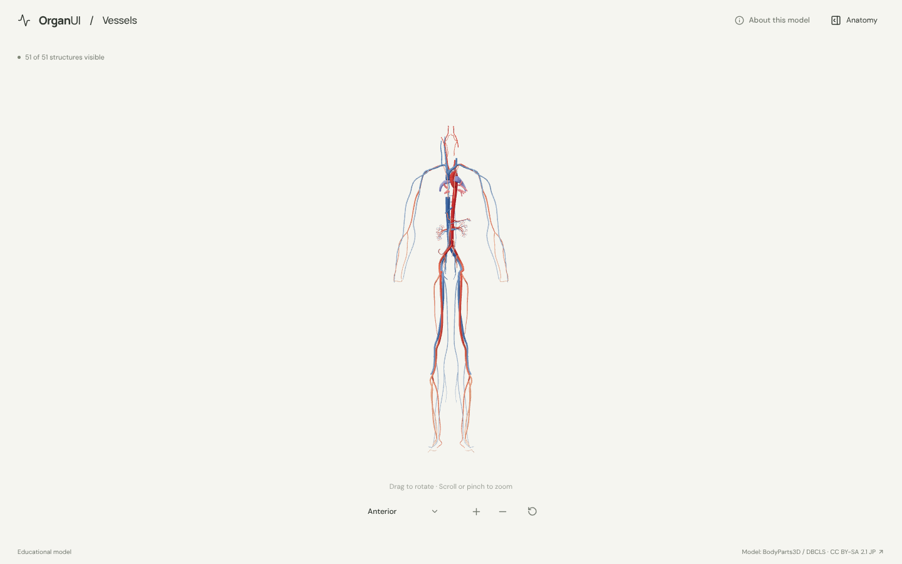
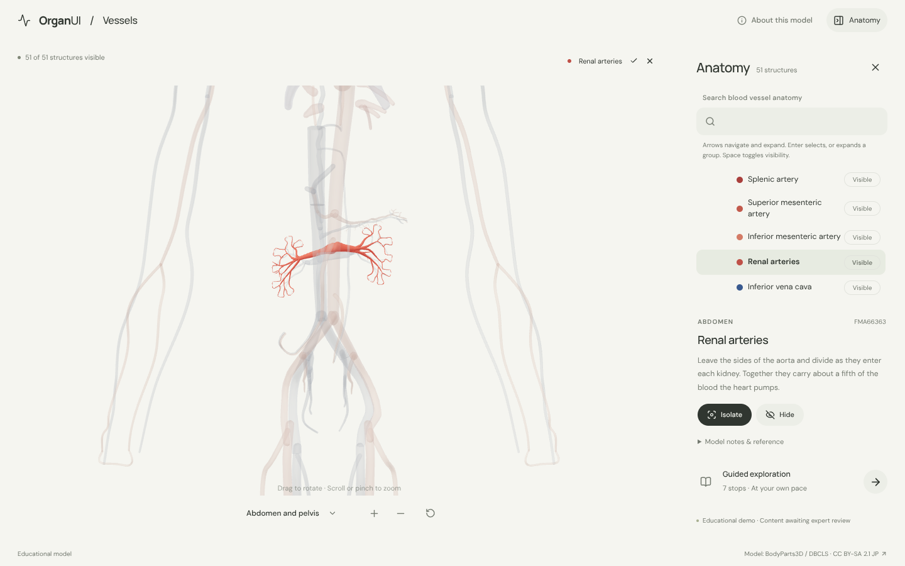
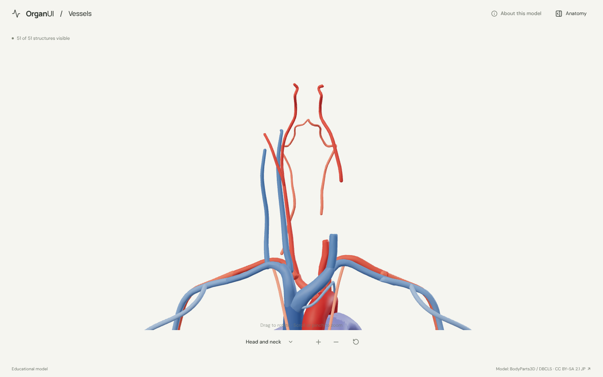
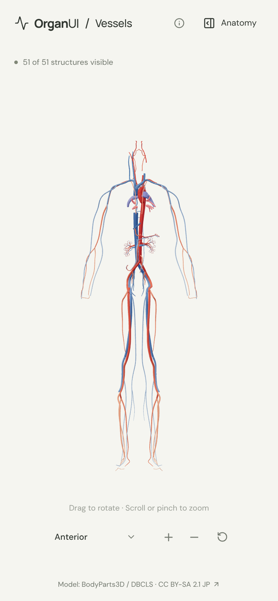

# OrganUI Vessels

A minimal, standalone, open-source explorer for the body's major blood vessels, built with React, TypeScript, Three.js, React Three Fiber, Vite, and Bun. It shares its interaction design and code with [OrganUI Heart](https://github.com/organui/heart-3d).

**Status:** working local demo. Fifty-one selectable arteries and veins from a real, openly licensed model, grouped by body region, with responsive layouts and checked desktop/mobile interactions. Public deployment and clinical anatomy review have not been completed.



## Run locally

Install [Bun](https://bun.sh/) **1.4.2 or newer**, then:

```sh
git clone https://github.com/organui/vessels-3d.git
cd vessels-3d
bun install --frozen-lockfile
bun run dev
```

Open **http://127.0.0.1:5173**. No environment variables, accounts, API keys, sibling repositories, model downloads, or external font services are needed after dependency installation. The ready-to-use 2.4 MB GLB is in `public/models/`.

```sh
bun run typecheck       # TypeScript checks, including conversion scripts
bun run test            # Unit tests for selection emphasis, views, colours, ownership, and the anatomy-tree adapter
bun run verify:model    # Check the GLB hash, source IDs, element lists, and valid geometry
bun run build           # Typecheck and create dist/
bun run preview         # Serve the production build at http://127.0.0.1:4173
bun run format:check    # Check formatting
```

The app is static and uses relative build paths. No deployment has been performed.

## Explore

- The whole body opens from the front. Open **Anatomy** in the header to browse vessels by region: head and neck, chest, arms, abdomen, pelvis and legs.
- Drag to rotate; scroll or pinch to zoom. The view menu has anterior and posterior views of the whole body, plus front views framed on the head and neck, the chest, the abdomen and pelvis, and the legs. Manual rotation changes its label to **Custom view**; zooming and selecting keep the view name.
- Select a mesh or use the anatomy tree (the OrganUI registry `anatomy-tree` component, see [registry integration](docs/REGISTRY_INTEGRATION.md)). The selected vessel glows in its own colour and everything else is ghosted.
- Isolate a vessel, hide it, or restore all. **Reset explorer** restores the anterior camera, visibility, selection, tree state and tour.
- Follow seven guided stops, from the aorta leaving the heart, up the carotids, down to the kidneys and legs, and back up the veins.
- Keyboard: Tab/Enter for controls, arrow keys to rotate the focused model, `+`/`-` to zoom, Escape closes the panel and returns focus to its toggle.

Arteries are red and veins blue. The pulmonary vessels are the exception: they follow the oxygen in the blood they carry, so the pulmonary arteries are blue and the pulmonary veins red.

<details>
<summary>Selection, region view and mobile screenshots</summary>







</details>

## Model, credits, and license

> BodyParts3D / Anatomography, © The Database Center for Life Science (DBCLS), licensed under Creative Commons Attribution-Share Alike 2.1 Japan. Adapted by OrganUI.

The model is a curated subset of **BodyParts3D / Anatomography 4.3**: 135 source meshes grouped into 51 structures and simplified from 521,538 to 121,908 triangles. The model data and screenshots of it are under **[CC BY-SA 2.1 Japan](https://creativecommons.org/licenses/by-sa/2.1/jp/deed.en)**, separately from this repository's **MIT code license**. Meshes come from a checksum-pinned public mirror and are cross-checked against the official 4.3 concept table. Read [model provenance](docs/MODEL_PROVENANCE.md), [asset attribution](public/models/ATTRIBUTION.md) and the [manifest](public/models/manifest.json).

Descriptions summarise the [NCI SEER Training pages on blood vessels](https://training.seer.cancer.gov/anatomy/cardiovascular/blood/) and general anatomy. **Expert anatomical review is pending.** This is an educational interface demonstration, not a diagnostic or clinical tool.

Known limitations:

- Most vessels are left and right pairs selected together.
- The heart, the vessels inside organs (brain, lungs, liver, kidneys) and most small branches are omitted. Those are in the organ explorers.
- The source is uneven between sides in the neck: the external carotid and external jugular exist only on the right, the left internal jugular is a short segment, and the left carotid has a gap where it divides.
- Meshes are simplified for size; thin vessels keep their path but lose fine surface detail.
- Browser checks used headless Chromium with software WebGL at desktop and phone viewport sizes, not physical devices or a screen-reader audit.

## License

Original application code: [MIT](LICENSE). Anatomy model, derived model images, fonts, and icons retain their separately documented licenses.

Part of [OrganUI](https://github.com/organui).
